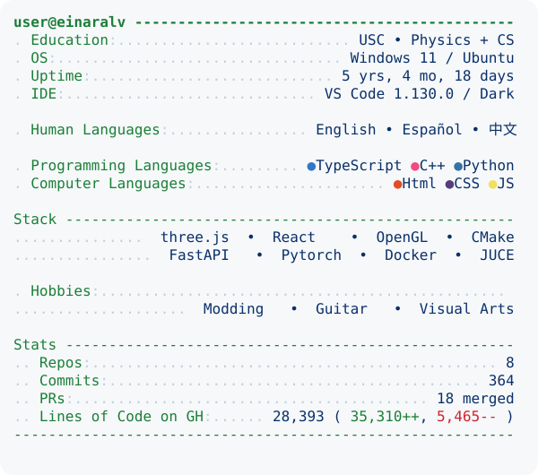

<!-- PROFILE-DATA
{"repos":8,"commits":364,"prs":18,"loc":28393,"last_updated":"2026-11-09T05:21:53Z","links":["https://github.com/EinarAl","https://monoscript-studio.vercel.app","https://chladni-tuner.vercel.app"]}
-->
<picture>
  <source media="(prefers-color-scheme: dark)" srcset="https://raw.githubusercontent.com/EinarAl/EinarAl/main/dark_mode.svg?v=1794201713">
  <source media="(prefers-color-scheme: light)" srcset="https://raw.githubusercontent.com/EinarAl/EinarAl/main/light_mode.svg?v=1794201713">
  
</picture>
